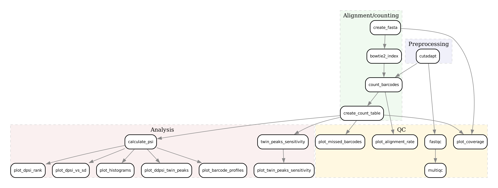
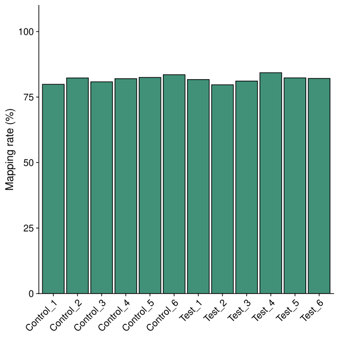
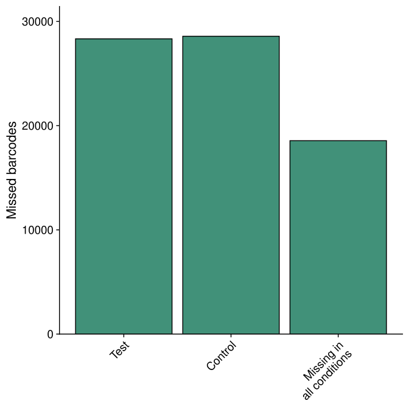
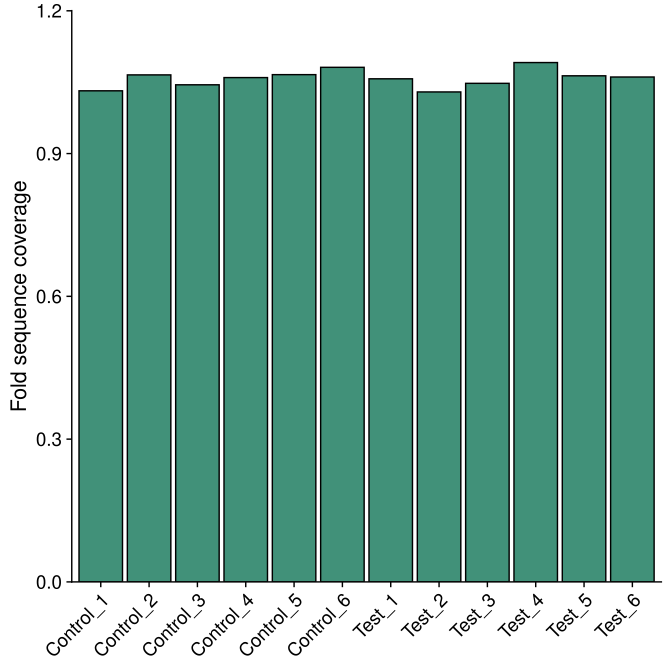
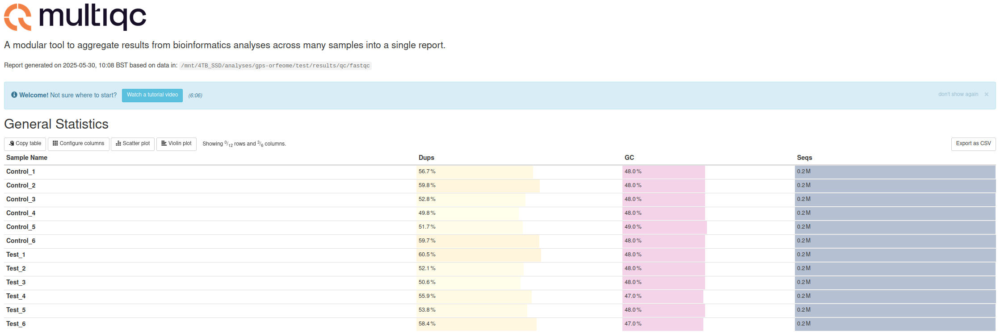
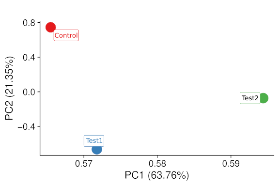
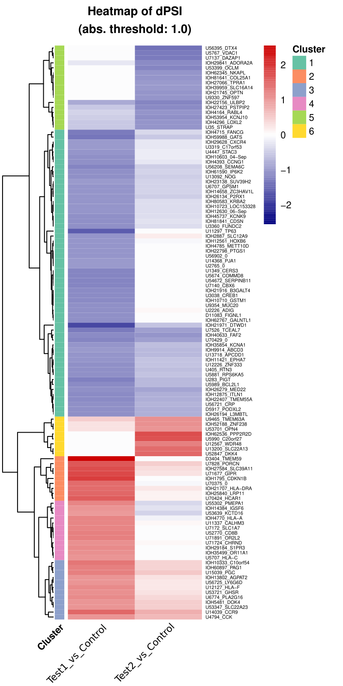

================================================================================
Output files by directory
================================================================================

Images
============

The rule graph (located in `images/`) of the workflow:

   Rule graph of the GPSW workflow (dPSI analysis)

Logs
======

The `logs/` directory contains the log files of the workflow. 

.. dropdown:: Directory structure
   :icon: info
   :color: primary

   .. code-block:: text
      
      logs/
      ├── bowtie2
      │   └── index.log
      ├── calculate_psi
      │   └── Test_vs_Control
      │       └── hit-th1.25_prop_th0.4.log
      ├── count
      │   ├── aggregate_counts.log
      │   ├── Control_1.log
      │   ├── Control_2.log
      │   ├── Control_3.log
      │   ├── Control_4.log
      │   ├── Control_5.log
      │   ├── Control_6.log
      │   ├── Test_1.log
      │   ├── Test_2.log
      │   ├── Test_3.log
      │   ├── Test_4.log
      │   ├── Test_5.log
      │   └── Test_6.log
      ├── create_fasta.log
      ├── cutadapt
      │   ├── Control_1.log
      │   ├── Control_2.log
      │   ├── Control_3.log
      │   ├── Control_4.log
      │   ├── Control_5.log
      │   ├── Control_6.log
      │   ├── Test_1.log
      │   ├── Test_2.log
      │   ├── Test_3.log
      │   ├── Test_4.log
      │   ├── Test_5.log
      │   └── Test_6.log
      ├── fastqc
      │   ├── Control_1.log
      │   ├── Control_2.log
      │   ├── Control_3.log
      │   ├── Control_4.log
      │   ├── Control_5.log
      │   ├── Control_6.log
      │   ├── Test_1.log
      │   ├── Test_2.log
      │   ├── Test_3.log
      │   ├── Test_4.log
      │   ├── Test_5.log
      │   └── Test_6.log
      ├── missed-rgrnas.log
      ├── multiqc
      │   └── multiqc.log
      ├── plot-alignment-rate.log
      ├── plot-coverage.log
      ├── plot_histograms
      │   └── hit-th1.25_prop_th0.4_Test_vs_Control.log
      ├── plot_psi
      │   ├── ddpsi_twin_peaks_hit-th1.25_prop_th0.4_Test_vs_Control.log
      │   ├── dpsi_rank_hit-th1.25_prop_th0.4_Test_vs_Control.log
      │   ├── dpsi_vs_sd_hit-th1.25_prop_th0.4_Test_vs_Control.log
      │   ├── hit-th1.25_prop_th0.4_Test_vs_Control.log
      │   └── twin_peaks_sensitivity_hit-th1.25_prop_th0.4_Test_vs_Control.log
      ├── snakemake
      │   └── 2026-10-14_09-45-49_snakemake.log
      └── twin_peaks_sensitivity
         └── hit-th1.25_prop_th0.4_Test_vs_Control.log

dPSI calculation log
--------------------------

An important and informative log file is the `logs/calculate_psi/Test_vs_Control/hit-th1.25_prop_th0.4.log` file, which contains information about the normalisation and filtering steps of the barcodes. This file is generated by the `calculate_psi` rule and contains the following information:

.. code-block:: text

   INFO:2026-10-14 09:46:36:Filtering data for Test vs Control
   INFO:2026-10-14 09:46:37:  Barcodes present pre-filtering: 135057
   INFO:2026-10-14 09:46:37:  Barcodes with no counts in any sample: 20350
   INFO:2026-10-14 09:46:37:  Largest sample: Test_4 with 130056.0 reads
   INFO:2026-10-14 09:46:37: Normalising Control_1 by 1.1223915632497368
   INFO:2026-10-14 09:46:37: Normalising Control_2 by 1.017143214665582
   INFO:2026-10-14 09:46:37: Normalising Control_3 by 1.099374471682164
   INFO:2026-10-14 09:46:37: Normalising Control_4 by 1.0879887567133464
   INFO:2026-10-14 09:46:37: Normalising Control_5 by 1.082374873083773
   INFO:2026-10-14 09:46:37: Normalising Control_6 by 1.0340780790331559
   INFO:2026-10-14 09:46:37: Normalising Test_1 by 1.033757521322004
   INFO:2026-10-14 09:46:37: Normalising Test_2 by 1.133869800612026
   INFO:2026-10-14 09:46:37: Normalising Test_3 by 1.1098064648257502
   INFO:2026-10-14 09:46:37: Normalising Test_4 by 1.0
   INFO:2026-10-14 09:46:37: Normalising Test_5 by 1.0798495503948056
   INFO:2026-10-14 09:46:37: Normalising Test_6 by 1.0998114212747245
   INFO:2026-10-14 09:46:37:  Barcodes with low counts in both reference and test condition: 100271
   INFO:2026-10-14 09:46:37:  Barcodes with no counts for Test in any bin: 0
   INFO:2026-10-14 09:46:37:  ORFs removed with less than 2 barcodes after filtering: 3824
   INFO:2026-10-14 09:46:37:  Number of barcodes present post-filtering: 10612
   INFO:2026-10-14 09:46:37:  Marking twin peaked barcodes in:
   INFO:2026-10-14 09:46:37:    Test
   INFO:2026-10-14 09:46:40:    Control
   INFO:2026-10-14 09:46:44:  Barcodes marked as having twin peaks: 2770
   INFO:2026-10-14 09:46:44:  ORFs removed with less than 2 barcodes after removing  barcodes with twin peaks: 1937
   INFO:2026-10-14 09:46:45:Computing PSI values for Test vs Control
   INFO:2026-10-14 09:46:45:Calculating proportions of reads in bins
   INFO:2026-10-14 09:46:45:Writing barcode-level results to results/psi/hit-th1.25_prop_th0.4/Test_vs_Control_barcode.summary.csv
   INFO:2026-10-14 09:46:45:Calling hits
   INFO:2026-10-14 09:46:45:  Number of stabilised ORFs in Test_vs_Control: 3
   INFO:2026-10-14 09:46:45:  Number of destabilised ORFs in Test_vs_Control: 10
   INFO:2026-10-14 09:46:45:  Number of hits supported by a single barcode: 0
   INFO:2026-10-14 09:46:45:Ranking hits
   INFO:2026-10-14 09:46:45:Writing ranked results to results/psi/hit-th1.25_prop_th0.4/Test_vs_Control_gene.summary.csv
   INFO:2026-10-14 09:46:45:Done

Resources
==========

The `resources/` directory contains the following files/directory:

- `<name>.csv`: a CSV file with the ORF metadata, including the ORF ID, gene name, and other relevant information (placed by the user).
- `<name>.fasta`: a FASTA file with the ORF sequences (generated by GPSW).
- `bowtie2_index/`: a directory containing the Bowtie2 index files for the ORF sequences (generated by GPSW).

Results
==============

The output files of the workflow are stored in the `results/` directory. The structure of the output files is as follows:

.. dropdown:: Directory structure
   :icon: info
   :color: primary

   .. code-block:: text

      results/
      ├── count
      │   └── counts-aggregated.tsv
      ├── psi
      │   └── hit-th1.25_prop_th0.4
      │       ├── Test_vs_Control_barcode.summary.csv
      │       ├── Test_vs_Control_ddpsi_twin_peaks.csv
      │       ├── Test_vs_Control_gene.summary.csv
      │       └── Test_vs_Control_twin_peaks_sensitivity.csv
      ├── psi_plots
      │   └── hit-th1.25_prop_th0.4
      │       ├── Test_vs_Control
      │       │   ├── destabilised
      │       │   │   ├── 10_IFITM3_IOH3178.pdf
      │       │   │   ├── 1_ADAMTS5_IOH82044.pdf
      │       │   │   ├── 2_RPS18_IOH41520.pdf
      │       │   │   ├── 3_CXorf40B_IOH9866.pdf
      │       │   │   ├── 4_C6orf201_U11005.pdf
      │       │   │   ├── 5_PDPN_IOH46102.pdf
      │       │   │   ├── 6_GNAS_IOH39616.pdf
      │       │   │   ├── 7_ACAT1_IOH13002.pdf
      │       │   │   ├── 8_C14orf147_IOH13958.pdf
      │       │   │   └── 9_TMEM43_IOH27841.pdf
      │       │   └── stabilised
      │       │       ├── 1_CHST9_IOH80001.pdf
      │       │       ├── 2_APOA2_IOH7290.pdf
      │       │       └── 3_XKR8_IOH14631.pdf
      │       ├── Test_vs_Control_ddpsi_twin_peaks.pdf
      │       ├── Test_vs_Control_dpsi_histogram.pdf
      │       ├── Test_vs_Control_dpsi_rank.pdf
      │       ├── Test_vs_Control_dpsi_sd_histogram.pdf
      │       ├── Test_vs_Control_dpsi_vs_sd.pdf
      │       ├── Test_vs_Control_psi_histogram.pdf
      │       ├── Test_vs_Control_sob_histogram.pdf
      │       └── Test_vs_Control_twin_peaks_sensitivity.pdf
      ├── qc
      │   ├── alignment-rates.csv
      │   ├── alignment-rates.pdf
      │   ├── fastqc
      │   │   ├── Control_1_fastqc.zip
      │   │   ├── Control_1.html
      │   │   ├── Control_2_fastqc.zip
      │   │   ├── Control_2.html
      │   │   ├── Control_3_fastqc.zip
      │   │   ├── Control_3.html
      │   │   ├── Control_4_fastqc.zip
      │   │   ├── Control_4.html
      │   │   ├── Control_5_fastqc.zip
      │   │   ├── Control_5.html
      │   │   ├── Control_6_fastqc.zip
      │   │   ├── Control_6.html
      │   │   ├── Test_1_fastqc.zip
      │   │   ├── Test_1.html
      │   │   ├── Test_2_fastqc.zip
      │   │   ├── Test_2.html
      │   │   ├── Test_3_fastqc.zip
      │   │   ├── Test_3.html
      │   │   ├── Test_4_fastqc.zip
      │   │   ├── Test_4.html
      │   │   ├── Test_5_fastqc.zip
      │   │   ├── Test_5.html
      │   │   ├── Test_6_fastqc.zip
      │   │   └── Test_6.html
      │   ├── missed-barcodes.pdf
      │   ├── multiqc.html
      │   └── sequence-coverage.pdf
      └── trimmed
         ├── Control_1.qc.txt
         ├── Control_2.qc.txt
         ├── Control_3.qc.txt
         ├── Control_4.qc.txt
         ├── Control_5.qc.txt
         ├── Control_6.qc.txt
         ├── Test_1.qc.txt
         ├── Test_2.qc.txt
         ├── Test_3.qc.txt
         ├── Test_4.qc.txt
         ├── Test_5.qc.txt
         └── Test_6.qc.txt

      11 directories, 67 files

Count
--------------------------------------------------------------------------------
The `count` directory contains the aggregated, non-normalised counts of barcodes across all conditions and bins (`counts-aggregated.tsv`).

.. list-table::
   :header-rows: 1
   :widths: 25 10 10 3 3 3 3 3 3 3 3 3 3 3 3 

   * - barcode_id
     - orf_id
     - gene
     - Control_1
     - Control_2
     - Control_3
     - Control_4
     - Control_5
     - Control_6
     - Test_1
     - Test_2
     - Test_3
     - Test_4
     - Test_5
     - Test_6
   * - 1_IOH10003_2802_PLD2
     - IOH10003
     - PLD2
     - 0
     - 2
     - 0
     - 11
     - 12
     - 0
     - 0
     - 5
     - 3
     - 11
     - 9
     - 0
   * - 2_IOH10003_2802_PLD2
     - IOH10003
     - PLD2
     - 1
     - 3
     - 1
     - 11
     - 12
     - 3
     - 0
     - 3
     - 6
     - 13
     - 7
     - 3
   * - 3_IOH10003_2802_PLD2
     - IOH10003
     - PLD2
     - 0
     - 29
     - 8
     - 51
     - 126
     - 66
     - 17
     - 7
     - 36
     - 0
     - 12
     - 0

PSI
--------------------------------------------------------------------------------
For each combination of hit threshold, proportion threshold and penalty factor, the `psi` directory contains the following files:

- ``Test_vs_Control_barcode.summary.csv``: a CSV file with barcode-level results.

   .. list-table::
      :header-rows: 1

      * - Comparison
        - barcode_id
        - orf_id
        - gene
        - Control_1
        - Control_2
        - Control_3
        - Control_4
        - Control_5
        - Control_6
        - Test_1
        - Test_2
        - Test_3
        - Test_4
        - Test_5
        - Test_6
        - SOB_Control
        - SOB_Test
        - num_barcodes
        - twin_peaks
        - good_barcodes
        - PSI_Control
        - PSI_Test
        - PSI_Control_mean
        - PSI_Test_mean
        - deltaPSI
        - delta_PSI_mean
        - delta_PSI_SD
        - agreeing_barcodes
      * - Test_vs_Control
        - 18_IOH10009_315_C9orf80
        - IOH10009
        - C9orf80
        - 0.0
        - 0.0
        - 0.059
        - 0.0
        - 0.471
        - 0.471
        - 0.036
        - 0.0
        - 0.0
        - 0.107
        - 0.5
        - 0.357
        - 17.0
        - 28.0
        - 4
        - False
        - 4
        - 5.353
        - 5.107
        - 5.151
        - 5.025
        - -0.246
        - -0.126
        - 0.149
        - 3
      * - Test_vs_Control
        - 19_IOH10009_315_C9orf80
        - IOH10009
        - C9orf80
        - 0.0
        - 0.071
        - 0.071
        - 0.0
        - 0.286
        - 0.571
        - 0.0
        - 0.048
        - 0.0
        - 0.048
        - 0.429
        - 0.476
        - 14.0
        - 21.0
        - 4
        - False
        - 4
        - 5.214
        - 5.286
        - 5.151
        - 5.025
        - 0.071
        - -0.126
        - 0.149
        - 3
      * - Test_vs_Control
        - 20_IOH10009_315_C9orf80
        - IOH10009
        - C9orf80
        - 0.0
        - 0.05
        - 0.0
        - 0.35
        - 0.3
        - 0.3
        - 0.0
        - 0.0
        - 0.059
        - 0.235
        - 0.647
        - 0.059
        - 20.0
        - 17.0
        - 4
        - False
        - 4
        - 4.8
        - 4.706
        - 5.151
        - 5.025
        - -0.094
        - -0.126
        - 0.149
        - 3

- ``Test_vs_Control_gene.summary.csv``: a CSV file with the gene-level results. This file contains, among others, the mean dPSI for each gene, and whether a gene is stabilised/destabilised in the test condition compared to the control condition, as well as an associated ranking. ``agreeing_barcodes`` is the number of good barcodes whose dPSI has the same sign as the mean dPSI of the ORF, and ``single_barcode_hit`` is ``True`` for hits that are supported by fewer than two such barcodes (i.e. hits likely driven by a single barcode). These columns do not affect hit calling or ranking.

   .. list-table::
      :header-rows: 1

      * - orf_id
        - gene
        - good_barcodes
        - delta_PSI_mean
        - delta_PSI_SD
        - agreeing_barcodes
        - stabilised
        - destabilised
        - single_barcode_hit
        - stabilised_rank
        - destabilised_rank
      * - IOH80001
        - CHST9
        - 2
        - 1.731
        - 2.044
        - 2
        - True
        - False
        - False
        - 1
        - NA
      * - IOH7290
        - APOA2
        - 2
        - 1.391
        - 1.091
        - 2
        - True
        - False
        - False
        - 2
        - NA
      * - IOH14631
        - XKR8
        - 4
        - 1.388
        - 1.044
        - 4
        - True
        - False
        - False
        - 3
        - NA

PSI Plots
--------------------------------------------------------------------------------

The `psi_plots` directory contains the following subdirectories for each combination of hit threshold, SD threshold, proportion threshold and penalty factor:

- `Test_vs_Control`: contains the following subdirectories:
   * `destabilised_in_Test`: contains PDF files with the barcode profiles for each destabilised gene in the test condition.
      * `stabilised_in_Test`: contains PDF files with the barcode profiles for each stabilised gene in the test condition.

  Example of barcode profile:

  .. figure:: images/profile.png
     :alt: Barcode profile for a stabilised gene in the test condition

     Barcode profile for a stabilised gene in the test condition.

- `Test_vs_Control_dpsi_rank.pdf`: a PDF file with a dot plot of the mean dPSI of each ORF, ranked from lowest to highest. Stabilised and destabilised ORFs (based on the hit threshold, shown as dashed lines) are coloured green and red, respectively, and the 15 ORFs with the lowest and highest dPSI values are labelled.

  .. figure:: images/dotplot.png
     :alt: Ranked dPSI values of all ORFs in the test condition compared to the control condition

     Ranked dPSI values of all ORFs in the test condition compared to the control condition.

- `Test_vs_Control_ddpsi_twin_peaks.pdf` (only when ``exclude_twin_peaks`` is ``True``): a PDF file with a dot plot of the difference in mean dPSI of each ORF with twin peak barcodes included versus excluded (ddPSI = included - excluded), ordered from lowest to highest. ORFs without twin peak barcodes have a ddPSI of 0. ORFs whose absolute dPSI passes the hit threshold in only one of the two analyses are coloured red and counted, and those with the largest ddPSI at either end are labelled. The underlying data is written to `results/psi/hit-th{ht}_prop_th{pt}/Test_vs_Control_ddpsi_twin_peaks.csv`.

.. note::

   Proteins whose :math:`|dPSI_i|` is smaller than the mean :math:`|dPSI_i|` are omitted from the plots to avoid visual clutter around the origin.

- `Test_vs_Control_psi_histogram.pdf`: a PDF file with a histogram of the :math:`\Psi_i` values for all genes.

  .. figure:: images/psi_histogram.png
     :alt: Histogram of PSI values

     Histogram of PSI values.

- `Test_vs_Control_dpsi_histogram.pdf`: a PDF file with a histogram of the :math:`dPSI_i` values for all genes.

  .. figure:: images/dpsi_histogram.png
     :alt: Histogram of delta PSI values

     Histogram of delta PSI values.

- `Test_vs_Control_dpsi_sd_histogram.pdf`: a PDF file with a histogram of the :math:`dPSI_i` SD values for all genes.

  .. figure:: images/sd_histogram.png
     :alt: Histogram of delta PSI SD values

     Histogram of delta PSI SD values.

- `Test_vs_Control_sob_histogram.pdf`: a PDF file with a histogram of the sum of barcodes (SOB) values for all genes per condition.

  .. figure:: images/sob_histogram.png
     :alt: Histogram of SOB values

     Histogram of SOB values. Only the 99.9th percentile of SOB values is shown in the histogram.

QC
--------------------------------------------------------------------------------

Alignment rates of individual samples
^^^^^^^^^^^^^^^^^^^^^^^^^^^^^^^^^^^^^^^^^^^^^^^^^^^^^^^^^^^^^^^^^^^^^^^^^^^^^^^^
`Bowtie2` alignment rates for each sample are visualised in `alignment-rates.pdf` file.

   Alignment rates of individual samples.

Missed barcodes
^^^^^^^^^^^^^^^^^^^^^^^^^^^^^^^^^^^^^^^^^^^^^^^^^^^^^^^^^^^^^^^^^^^^^^^^^^^^^^^^
The `missed-barcodes.pdf` file contains a plot of the number of barcodes that were not detected in each bin for each condition. This is useful to identify bins with low coverage or issues with barcode detection.

   Missed barcodes.

Sequence coverage
^^^^^^^^^^^^^^^^^^^^^^^^^^^^^^^^^^^^^^^^^^^^^^^^^^^^^^^^^^^^^^^^^^^^^^^^^^^^^^^^
The `sequence-coverage.pdf` file contains a plot of the sequence coverage across all bins for each condition. This is useful to identify bins with low coverage or issues with barcode detection.

   Sequence coverage.

The sequence coverage is calculated by dividing the number of sequencing reads in each bin by the total number of barcodes in the ORF library.

MultiQC report
^^^^^^^^^^^^^^^^^^^^^^^^^^^^^^^^^^^^^^^^^^^^^^^^^^^^^^^^^^^^^^^^^^^^^^^^^^^^^^^^
The `multiqc.html` file contains a summary of the quality control metrics for the trimmed reads.

   MultiQC report.

Trimmed
--------------------------------------------------------------------------------
The `trimmed` directory contains the quality control files for each sample after trimming with `cutadapt`. These files contain information about the number of reads before and after trimming, the number of reads that were discarded, and the number of reads that were kept.

.. dropdown:: Example of a trimmed sample quality control file
   :icon: info
   :color: primary

   .. code-block:: text

      This is cutadapt 4.9 with Python 3.12.13
      Command line parameters: --cores 4 -g CCAGTAGGTCCACTATGAGT...AGCTGTGTAAGCGGAACTAG -m 24 -M 30 --discard-untrimmed -o results/trimmed/Control_1.fastq.gz reads/Control_1.fastq.gz
      Processing single-end reads on 4 cores ...
      Finished in 1.009 s (5.763 µs/read; 10.41 M reads/minute).

      === Summary ===

      Total reads processed:                 175,000
      Reads with adapters:                   171,199 (97.8%)

      == Read fate breakdown ==
      Reads that were too short:               1,179 (0.7%)
      Reads that were too long:                4,669 (2.7%)
      Reads written (passing filters):       169,152 (96.7%)

      Total basepairs processed:    26,250,000 bp
      Total written (filtered):      4,554,571 bp (17.4%)

      === Adapter 1 ===

      Sequence: CCAGTAGGTCCACTATGAGT...AGCTGTGTAAGCGGAACTAG; Type: linked; Length: 20+20; 5' trimmed: 171199 times; 3' trimmed: 171199 times

      Minimum overlap: 3+3
      No. of allowed errors:
      1-9 bp: 0; 10-19 bp: 1; 20 bp: 2

      No. of allowed errors:
      1-9 bp: 0; 10-19 bp: 1; 20 bp: 2

      Overview of removed sequences at 5' end
      length	count	expect	max.err	error counts
      3	115	2734.4	0	115
      4	1	683.6	0	1
      18	3	0.0	1	2 1
      19	47	0.0	1	6 38 3
      20	19580	0.0	2	17129 2155 296
      21	19625	0.0	2	17229 2112 284
      22	23834	0.0	2	20994 2506 334
      23	24882	0.0	2	21758 2723 401
      24	22684	0.0	2	19883 2464 337
      25	23524	0.0	2	20627 2455 442
      26	20396	0.0	2	17727 2250 419
      27	16467	0.0	2	14327 1833 307
      28	33	0.0	2	13 17 3
      31	1	0.0	2	1
      32	1	0.0	2	0 0 1
      33	1	0.0	2	1
      36	1	0.0	2	1
      37	1	0.0	2	1
      38	1	0.0	2	1
      40	1	0.0	2	1
      47	1	0.0	2	1

      Overview of removed sequences at 3' end
      length	count	expect	max.err	error counts
      3	149	2734.4	0	149
      4	1	683.6	0	1
      5	2	170.9	0	2
      8	1	2.7	0	1
      43	1	0.0	2	1
      66	1	0.0	2	1
      67	1	0.0	2	1
      69	1	0.0	2	1
      73	2	0.0	2	2
      75	1	0.0	2	1
      81	1	0.0	2	1
      82	1	0.0	2	0 1
      83	1	0.0	2	1
      84	2	0.0	2	2
      85	1	0.0	2	0 1
      86	1	0.0	2	1
      87	2	0.0	2	1 1
      88	6	0.0	2	3 1 2
      89	3	0.0	2	3
      90	1	0.0	2	0 1
      91	2	0.0	2	1 1
      92	60	0.0	2	50 9 1
      93	7837	0.0	2	6535 941 361
      94	9941	0.0	2	8274 1208 459
      95	11433	0.0	2	9697 1287 449
      96	11099	0.0	2	9423 1244 432
      97	12241	0.0	2	10328 1409 504
      98	11582	0.0	2	9809 1307 466
      99	17914	0.0	2	15117 2193 604
      100	19808	0.0	2	16695 2387 726
      101	12155	0.0	2	10232 1500 423
      102	11595	0.0	2	9666 1516 413
      103	12674	0.0	2	10573 1652 449
      104	12200	0.0	2	10222 1571 407
      105	10078	0.0	2	8463 1269 346
      106	9992	0.0	2	8382 1266 344
      107	126	0.0	2	109 13 4
      108	56	0.0	2	46 7 3
      109	33	0.0	2	27 3 3
      110	32	0.0	2	27 4 1
      111	22	0.0	2	21 0 1
      112	31	0.0	2	27 3 1
      113	20	0.0	2	18 2
      114	26	0.0	2	21 2 3
      115	18	0.0	2	14 2 2
      116	10	0.0	2	8 1 1
      117	10	0.0	2	7 3
      118	8	0.0	2	4 2 2
      119	1	0.0	2	1
      120	3	0.0	2	1 2
      121	6	0.0	2	1 5
      123	4	0.0	2	1 3
      124	1	0.0	2	0 1
      125	2	0.0	2	0 2

Output with multiple test conditions
======================================

When running the workflow with multiple test conditions, additional files will be created in *results/*.

PCA plot
--------------------------------------------------------------------------------
The `qc/pca_plot.pdf` file contains a PCA plot of the ORF counts for all conditions. This plot is useful to visualise the overall distribution of ORF counts across different conditions and to identify potential outliers.

   PCA plot of the ORF counts for all conditions.

Heatmap of :math:`dPSI_i` values of all comparisons
---------------------------------------------------------------------------------

The `psi_plots` directory contains pdf/csv files with the heatmap data of :math:`dPSI_i` values for each ORF found as hits in any of the comparisons.

   Heatmap of :math:`dPSI_i` values for all comparisons.

.. note::
  As the clustering algorithm does not allow missing data (some genes are not found in all comparisons), missing data is replaced with :math:`dPSI_i = 0`.